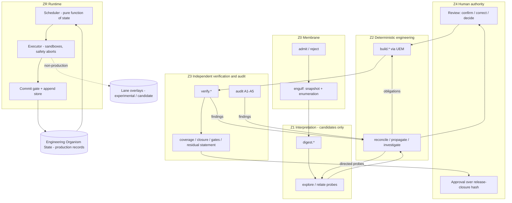
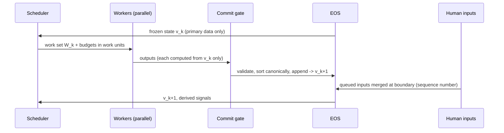
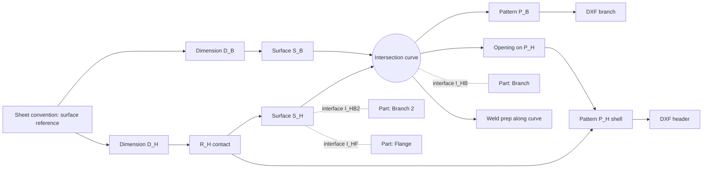
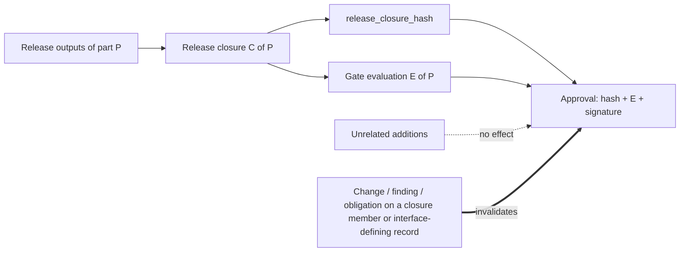
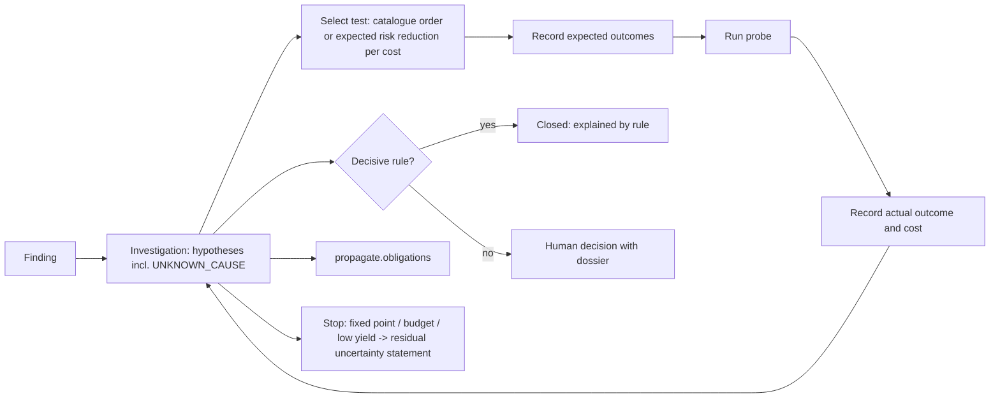

# AMOEBA Architecture Diagrams (updated)

Version 0.2 · 18 November 2026 · Reflects the refinement notes; proposed, not accepted in every detail (see the [Decision Register](../DECISION_REGISTER.md)). Diagrams are Mermaid and render on GitHub.

## 1. Governance layers

## 2. Round model

## 3. Dependency propagation (header with branch, Example 1)

Solid arrows: derivation (downstream invalidation, mandatory). Dotted: interfaces (lateral obligations). A change at `CONV` reaches `D_B` by common cause.

## 4. Approval and release closure

## 5. Investigation loop

