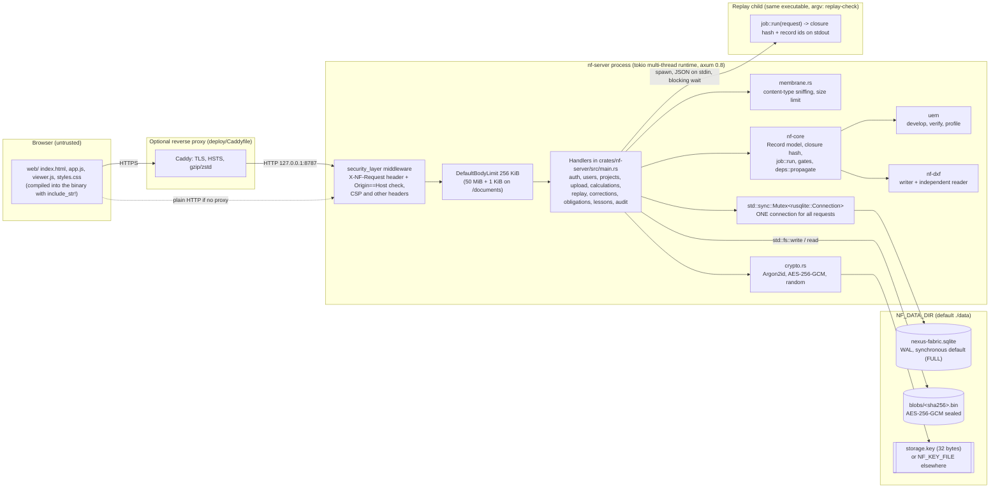
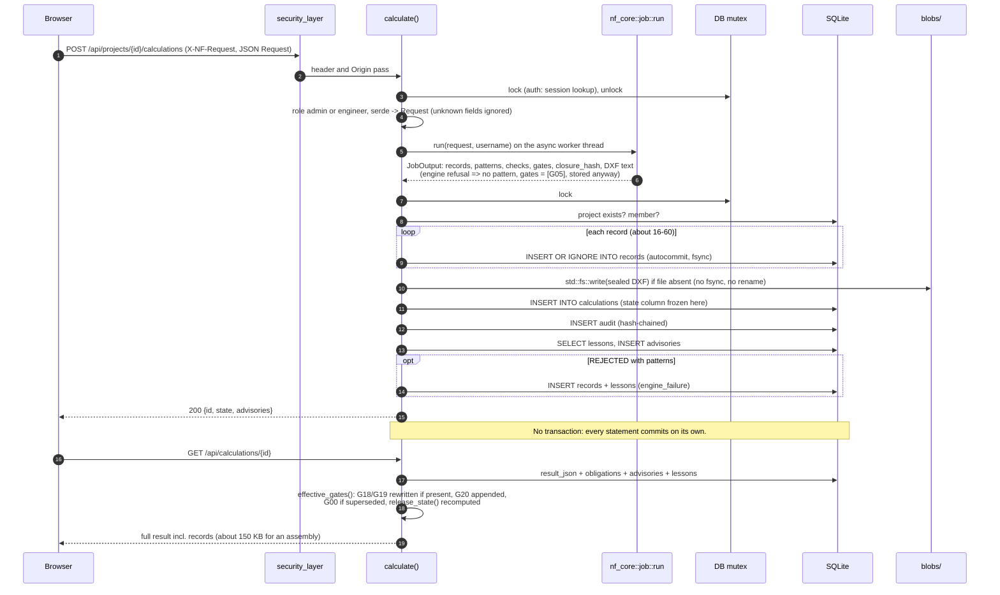
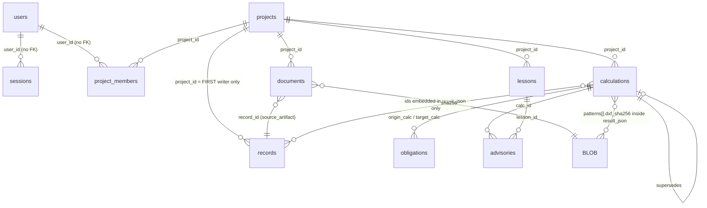
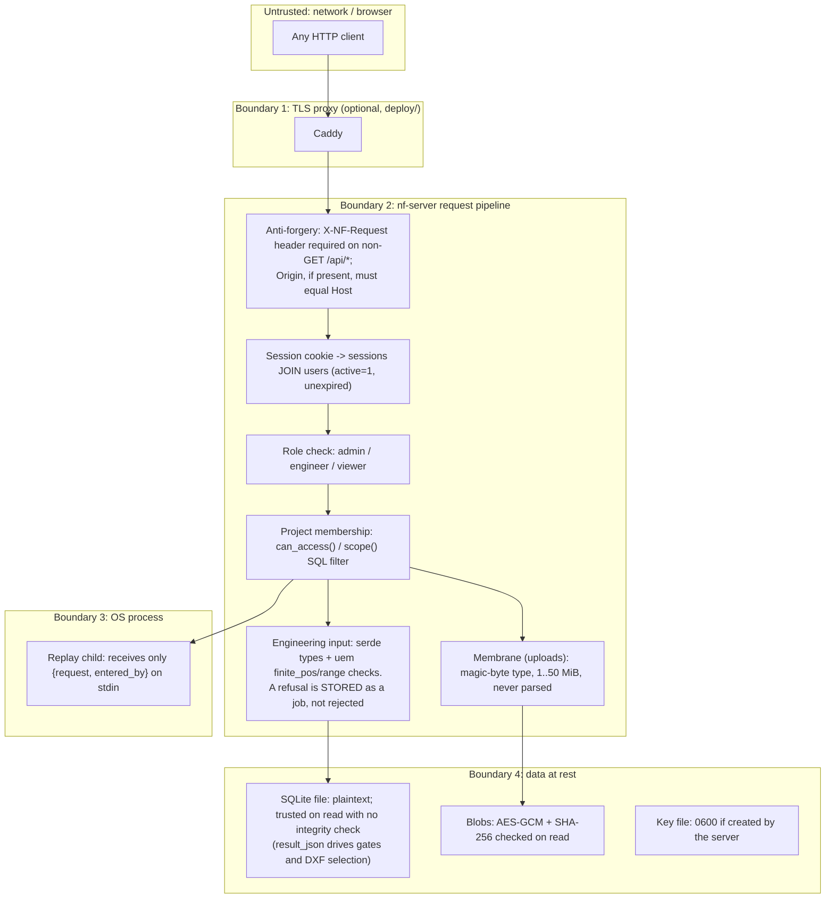

# Backend Architecture (as built)

Audit date 19 November 2026 · source of truth: `crates/` at commit `8f352ef` (release binary built 02:31 from a clean tree) · companion documents: [BACKEND_AUDIT.md](BACKEND_AUDIT.md), [DEFECT_REGISTER.md](DEFECT_REGISTER.md), [TECHNICAL_DEBT.md](TECHNICAL_DEBT.md).

This document describes what exists, not what the specifications plan. Everything here runs in **one operating-system process** (`nf-server`), plus a short-lived copy of the same executable started for each replay audit.

## 1. Components

Module boundaries:

| Crate | Lines | Role | I/O |
|---|---|---|---|
| `uem` | 1,124 | Developments (cylinder, cone, eccentric cone, branch stub, header with opening), verification checks, profile topology, bend formulas (library only) | none |
| `nf-dxf` | 328 | R12 subset writer, independent reader, re-import comparison | none |
| `nf-core` | 997 | Content-addressed `Record`, closure and closure hash, `job::run` (develop → verify → profile → DXF → re-import → gates), release-state rule, dependency propagation and obligation discharge | none |
| `nf-server` | 1,285 | Everything else: HTTP, auth, SQLite schema and queries, blob store, membrane, replay child, lessons/advisories, read-time gate evaluation | SQLite, files, child process |

The three library crates are pure and deterministic; all state, authorisation, persistence and read-time policy (G00, G18, G19, G20) live in one 1,115-line file, `crates/nf-server/src/main.rs`.

## 2. Data flow of a calculation job

Corrections (`POST /api/calculations/{id}/corrections`) hold the DB lock for the whole handler: attestation record → `job::run(new request)` → `persist_calc(supersedes = old)` → lesson → advisories → one finding record plus one `obligations` row per affected record.

Replay (`POST /api/calculations/{id}/replay`) reads the stored request, releases the lock, starts `current_exe() replay-check`, waits for it synchronously, then re-checks the identity of each stored record. It writes `replay_json` and may set `state = 'REJECTED'` plus an `integrity_failure` lesson.

## 3. Storage

- 12 tables, created with `CREATE TABLE IF NOT EXISTS` (`main.rs:53-66`). The only indexes are the implicit primary-key and unique ones (`users.username`, `sessions.token_hash`, `records.id`, `project_members` PK). There are no declared foreign keys (so `PRAGMA foreign_keys = ON` at `main.rs:1103` has no effect), no CHECK constraints, and no schema version (`PRAGMA user_version` = 0). Migrations are four `ALTER TABLE` statements whose errors are ignored (`main.rs:1105-1108`).
- `calculations.result_json` holds the whole `JobOutput`, including every record (about 148 KB for an assembly). The same records are also written to `records`. `calculations.state` is written once, at insert, and changed again only by a replay mismatch. `calculations.dxf_sha256` is never written.
- `records` is append-only through `INSERT OR IGNORE`, so a record keeps the `project_id` of the first project that produced it.
- Blob store: `blobs/<sha256-of-plaintext>.bin` = 12-byte nonce plus AES-256-GCM ciphertext. Uploaded documents and generated DXF share it. A blob is written only if no file with that name exists.
- Key: `NF_KEY_FILE`, or `NF_DATA_DIR/storage.key`. A new key is created whenever the file cannot be read.
- SQLite settings: `journal_mode = WAL` (`main.rs:1103`). `synchronous` is not set, so the SQLite default (FULL) applies. Busy timeout is not set, so rusqlite's 5,000 ms default applies (a request panicked after 5.07 s; see BACKEND_AUDIT §4). There are no explicit transactions anywhere.

## 4. Trust boundaries

Unauthenticated endpoints: `GET /api/health`, `POST /api/setup` (only while the `users` table is empty), `POST /api/login`, `POST /api/logout`, and the four static assets.

What is trusted without verification: everything read back from SQLite. Stored records are re-hashed only during a replay. `result_json` (gates, patterns, DXF hashes) is never checked against its closure hash on the read path; see BE-002.

## 5. Capabilities that do not exist (not audited)

| Capability named in the brief | Status in code |
|---|---|
| Structural frames, trusses, structural analysis | **Not implemented.** No code, types or endpoints. |
| Drawing ingestion / external DXF ingestion | **Not implemented.** `nf_dxf::read` is used only to re-import DXF text the server itself just wrote (`job.rs:262`). Uploaded files are never parsed (`membrane.rs:1-3`; the upload response says `"interpretation":"not implemented"`). |
| File upload | **Partly exists, contrary to the brief.** `POST /api/projects/{id}/documents` accepts raw bytes (≤ 50 MiB), sniffs the type (PDF, PNG, JPEG, TIFF, STEP, ASCII DXF), encrypts and stores the file, and records a snapshot. No content is interpreted. It is audited below as storage only. |
| Background job queue / scheduler | **Not implemented.** Every job runs synchronously inside the HTTP request. The only out-of-request work is the replay child, which is still awaited by the request. |
| Multi-service architecture | **Not implemented.** One binary, one process, one SQLite connection. The replay child is the same executable. |
